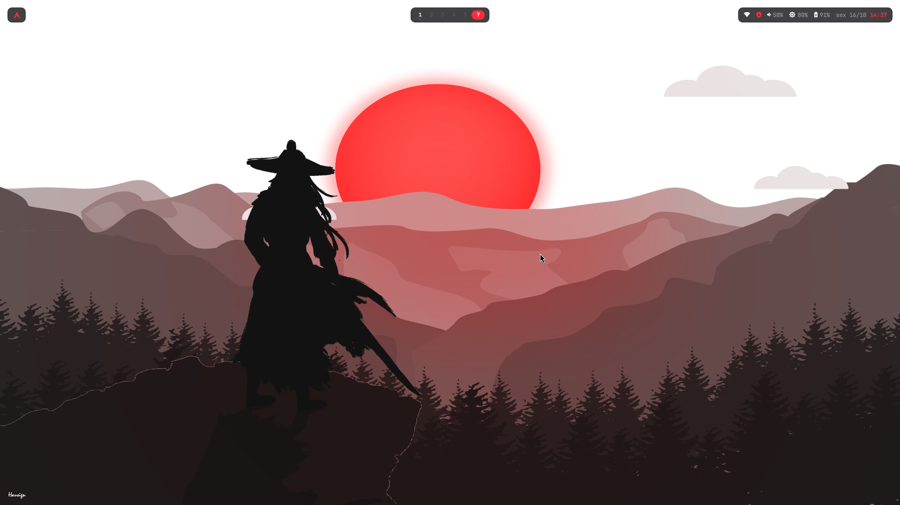
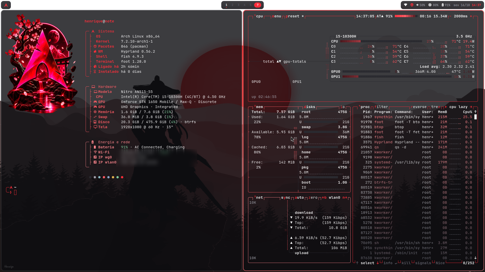
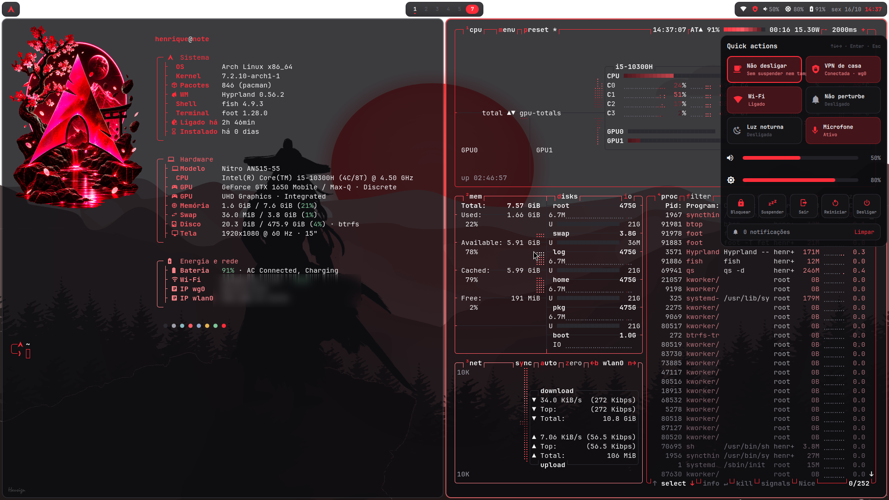
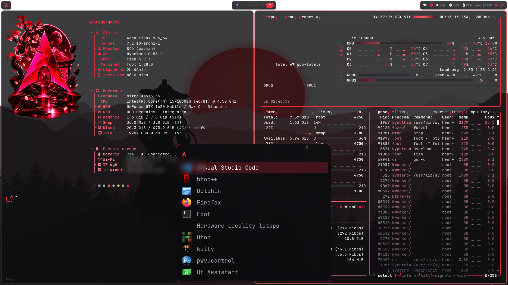
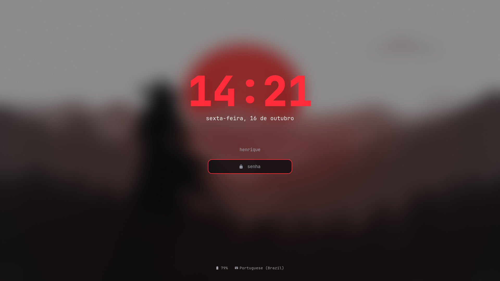

<div align="center">

# 󰣇 MyLTC

**Rice para Arch Linux + Hyprland, em vermelho e preto, feito para notebook e para usar mais o teclado que o mouse.**

Paleta tirada do [latenci.in](https://latenci.in) · shell próprio em [Quickshell](https://quickshell.org) · animações no estilo do [Illogical Impulse](https://github.com/end-4/dots-hyprland)

</div>



| Terminal (fish + Starship + fastfetch + btop) | Quick actions (`Super+N`) |
|---|---|
|  |  |
| **Launcher subindo de baixo** | **Tela de bloqueio** |
|  |  |

---

## Visual

| | |
|---|---|
| **Paleta** | `#ff2d39` vermelho · `#ff5b64` · `#ff858c` sobre `#0c0c0f` / `#141417` / `#2a2a30`, texto `#f4f4f5` |
| **Fontes** | Adwaita Sans (interface) · JetBrains Mono Nerd Font (terminal e barra) |
| **Cursor / ícones** | Adwaita 24 · Papirus-Dark |
| **Temas** | adw-gtk3-dark (GTK) · esquema `MyLTC` + Breeze (Qt/KDE) |

## O que tem

- **Barra adaptativa** (Quickshell): com a área vazia as ilhas ficam soltas, longe das bordas; com janelas abertas a barra encolhe e encosta no topo.
  - Esquerda: logo do Arch (abre o launcher) e a música tocando (clique = play/pause, rolar = próxima/anterior).
  - Centro: áreas de trabalho numeradas. A ativa fica numa pílula vermelha e as que têm janelas ganham um tracinho.
  - Direita: Wi-Fi, VPN, volume, brilho, bateria, data e hora. Clicar abre as quick actions.
- **Adaptativo de verdade:** o rice reage sozinho ao contexto do notebook.
  - Uma janela só na área: sem bordas nem espaços, aproveitando a tela inteira.
  - Fora da tomada: modo economia, sem desfoque e sem sombras (folha verde na barra). Na tomada volta tudo.
  - Bateria em 20%, 10% e 5%: avisos, e o de 5% é crítico.
  - Janela em tela cheia: as notificações não aparecem, só as críticas.
  - Das 19h às 6h30: a luz noturna liga sozinha. Mexer no botão vale até o próximo horário.
  - Monitor externo + tampa fechada: desliga só a tela do note e continua no monitor, sem suspender.
  - Áreas de trabalho além da 5 entram deslizando na barra e saem animadas quando ficam vazias.
- **Quick actions** (`Super+N`): painel escondido que desliza da direita, todo navegável pelo teclado.
  - Não desligar (bloqueia suspender, ociosidade e tampa), VPN WireGuard, Wi-Fi, não perturbe, luz noturna, microfone.
  - Sliders de volume e brilho, bloquear, suspender, sair, reiniciar/desligar com confirmação e limpar notificações.
- **Notificações** próprias (sem dunst), no estilo do rice.
- **OSD** de volume e brilho ao usar as teclas.
- **Launcher** (fuzzel) subindo de baixo, com o tema do rice.
- **Tela de bloqueio** (hyprlock) com relógio vermelho grande e data em português, e **hypridle** (escurece em 2,5 min, bloqueia em 5, apaga a tela em 5,5 e suspende em 15). Respeita o "Não desligar".
- **Terminal** foot translúcido, **fish** + **Starship** com a paleta, `eza`/`bat`/`zoxide`/`fzf`.
- **fastfetch**, **btop** e **cava** com o tema MyLTC.
- Animações do **Illogical Impulse** (troca de área em *slide* com `menu_decel`).

## Atalhos principais

| Atalho | Ação |
|---|---|
| `Super` | Launcher |
| `Super + T / W / C / E` | Terminal / Firefox / VS Code / Dolphin |
| `Super + Q` | Fechar janela |
| `Super + 1…0` · `Super + Alt + 1…0` | Ir para área · mover janela para área |
| `Ctrl + Super + ← / →` | Área anterior / próxima |
| `Super + setas` · `Super + Shift + setas` | Foco · mover janela |
| `Super + F` · `Super + Alt + F` · `Super + Alt + Espaço` | Tela cheia · maximizar · flutuar |
| `Super + N` | Quick actions |
| `Super + L` · `Super + Shift + L` | Bloquear · suspender |
| `Print` · `Super + Shift + S` | Print da tela · print de área |
| `Ctrl + Alt + R` | Gravar a tela (de novo para parar) |
| `Super + V` · `Super + .` | Histórico da área de transferência · emojis |
| `Ctrl + Alt + C` | Limpar notificações |
| `Ctrl + Super + Alt + R` | Reiniciar o shell |

A lista completa está em [`config/.config/hypr/keybinds.lua`](config/.config/hypr/keybinds.lua).

## Instalação

```sh
git clone https://github.com/henriquecarmellim/MyLTC.git
cd MyLTC
./install.sh            # pacotes + configs (faz backup do que já existe)
./install.sh --no-deps  # só as configs
```

O instalador faz backup das suas configs em `~/.config/myltc-backup-<data>`, baixa os wallpapers e pergunta antes de instalar a regra do polkit do botão de VPN.

> O botão **VPN** espera uma interface WireGuard `wg0` gerenciada pelo systemd-networkd. Se não for o seu caso, ele só não faz nada.

## Estrutura

```
config/.config/hypr/         Hyprland (Lua), atalhos, animações, hyprlock, hypridle, scripts
config/.config/quickshell/   barra, quick actions, notificações, OSD, wallpaper
config/.config/…             foot, fuzzel, fastfetch, fish, starship, btop, cava, gtk
config/.local/share/         esquema de cores MyLTC (KDE) e atalhos ocultos do launcher
system/                      regra do polkit (opcional)
```

## Créditos

- Animações: [end-4/dots-hyprland (Illogical Impulse)](https://github.com/end-4/dots-hyprland)
- Inspiração do layout de barra/quick actions: [Caelestia](https://github.com/caelestia-dots/shell)
- Wallpapers (baixados pelo instalador, não redistribuídos): [wallhaven 9mdyz8](https://wallhaven.cc/w/9mdyz8) (Hausign) e [wallhaven r2z7lm](https://wallhaven.cc/w/r2z7lm)

## Licença

[MIT](LICENSE)
